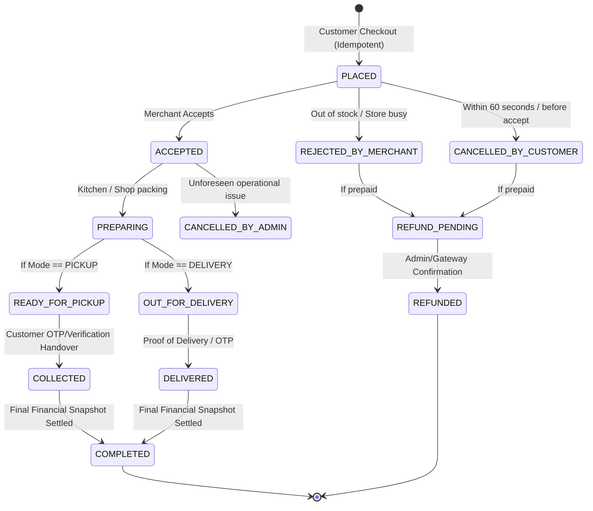

# 04. WORKFLOWS AND STATE MACHINES
## Product: Everything Local

---

## 1. Order State Machine

### State Definitions & Permitted Transitions:
1. `PLACED`: Order registered, inventory reserved, payment authorized.
2. `ACCEPTED`: Merchant acknowledged order and confirmed item availability.
3. `REJECTED`: Merchant declined. System rolls back inventory reservation and queues refund if prepaid.
4. `PREPARING`: Store staff packing items.
5. `READY_FOR_PICKUP`: For in-store pickup orders. Notification sent to customer.
6. `OUT_FOR_DELIVERY`: For delivery orders. Dispatched with merchant or delivery partner.
7. `DELIVERED` / `COLLECTED`: Fulfillment complete. Customer received order.
8. `COMPLETED`: Order closed, merchant ledger entry marked eligible for weekly settlement.
9. `CANCELLED`: Order cancelled by customer or admin prior to fulfillment.
10. `REFUNDED`: Reversal of payment executed and recorded in financial refund ledger.

---

## 2. Inventory Reservation State Machine
- When order transitions to `PLACED`: `reservedStock += quantity`, `availableStock = totalStock - reservedStock`.
- If order transitions to `ACCEPTED`: `totalStock -= quantity`, `reservedStock -= quantity` (Permanent sale).
- If order transitions to `REJECTED` or `CANCELLED`: `reservedStock -= quantity` (Re-released into available inventory).

---

## 3. Merchant Lifecycle State Machine
`APPLIED` -> `PENDING_REVIEW` -> `APPROVED` -> `ACTIVE` <-> `SUSPENDED` / `OFFLINE`.
Only `ACTIVE` merchants appear in customer search and can accept orders.
