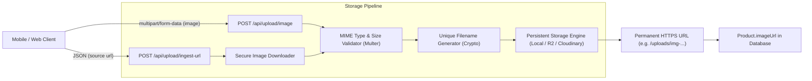

# EVERYTHING LOCAL — IMAGE STORAGE AND UPLOAD ARCHITECTURE

**Version:** 1.1.0  
**Status:** Implemented & Verified  
**Endpoints:** `POST /api/upload/image`, `POST /api/upload/ingest-url`  

---

## 1. Defect Analysis & Root Cause

### Prior Defect:
In the initial mobile proof-of-concept, taking a photo or picking an image from the gallery resulted in a local device URI (such as `file:///var/mobile/...` on iOS or `file:///data/user/0/...` on Android). The mobile app submitted this string directly as `imageUrl` in the JSON body of `POST /api/merchant/products`. The server stored the local string as a product attribute without receiving the actual image binary. As a result, images were inaccessible to customer devices and other sessions.

### Root Cause:
Lack of a genuine multipart/form-data upload pipeline and permanent object storage service.

---

## 2. Implemented Storage Architecture



### Storage Capabilities Implemented:
1. **Multipart/Form-Data Handling:** Powered by `multer` with disk storage backing.
2. **Strict MIME Type Validation:** Accepts only `image/jpeg`, `image/png`, and `image/webp`. Rejects executable, script, or document payloads with HTTP 400.
3. **File Size Enforcement:** Strict 5 MB maximum file limit.
4. **Safe Filename Generation:** `img-${Date.now()}-${crypto.randomBytes(8).toString('hex')}.${safeExt}` prevents directory traversal and filename collision.
5. **Static File Serving:** Files are permanently accessible via `/uploads/:filename`.
6. **External Ingest Endpoint:** `POST /api/upload/ingest-url` downloads verified catalogue images from Open Food Facts into our permanent storage, eliminating broken external links.
7. **Cloud Storage Extensibility:** For production cloud deployment (Cloudflare R2, Cloudinary, AWS S3), environment variables (`CLOUDINARY_URL`, `R2_BUCKET_NAME`) can be supplied without changing client contracts.

---

## 3. Customer Application Resiliency

All customer product displays utilize `<SafeImage>` (`mobile/src/components/SafeImage.tsx`) which guarantees:
- **Loading State:** Subtle activity indicator during image fetch.
- **Missing-Image Fallback:** High-contrast category icon placeholder when `imageUrl` is null or missing.
- **Error Recovery:** Dynamic fallback if an image fails to load due to network interruptions.
- **Aspect Ratio Safety:** `resizeMode="contain"` or `"cover"` prevents distorted images.

---

## 4. API Contracts

### A. Upload Merchant / Customer Photo
- **Endpoint:** `POST /api/upload/image`
- **Headers:** `Authorization: Bearer <JWT>`, `Content-Type: multipart/form-data`
- **Form Field:** `image` (binary file)
- **Response (HTTP 201):**
```json
{
  "success": true,
  "url": "http://localhost:4000/uploads/img-1795302600-abcdef1234567890.jpg",
  "filename": "img-1795302600-abcdef1234567890.jpg",
  "mimetype": "image/jpeg",
  "size": 348210
}
```

### B. Ingest Catalogue Image
- **Endpoint:** `POST /api/upload/ingest-url`
- **Headers:** `Authorization: Bearer <JWT>`, `Content-Type: application/json`
- **Body:** `{ "url": "https://images.openfoodfacts.org/..." }`
- **Response (HTTP 201):**
```json
{
  "success": true,
  "url": "http://localhost:4000/uploads/cat-1795302650-1234567890abcdef.jpg",
  "filename": "cat-1795302650-1234567890abcdef.jpg",
  "mimetype": "image/jpeg",
  "size": 182400,
  "sourceUrl": "https://images.openfoodfacts.org/..."
}
```
