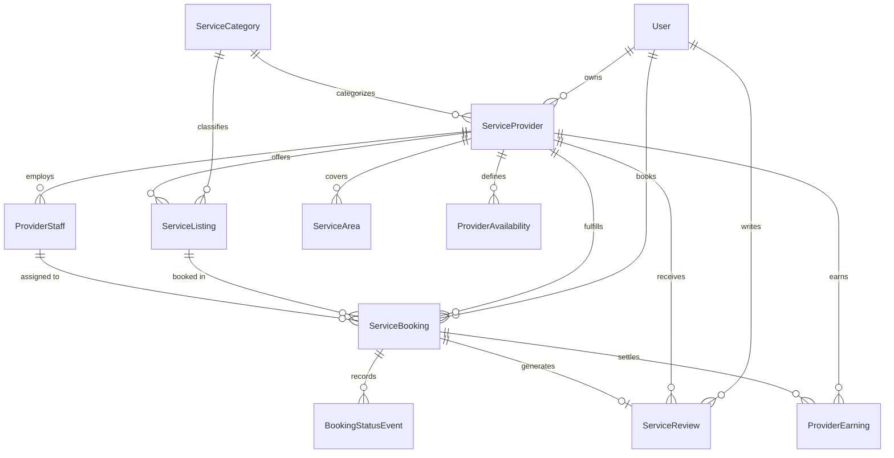

# Everything Local — Local Services Module Architecture

## 1. Overview & Vision
The **Local Services Booking Ecosystem** extends Everything Local into an integrated, dual-mode marketplace for the city of Indore. Beside **Local Commerce (Shop)** for 15-20 minute grocery and daily essentials delivery, customers can now seamlessly switch to **Services** to discover, schedule, and book certified local service professionals across 6 major sectors:

1. **Salon & Grooming** (haircuts, styling, beard grooming, facials)
2. **Beauty & Wellness** (bridal makeup, skin therapy, spa sessions)
3. **Home Maintenance** (certified electricians, plumbers, carpenters, appliance repairs)
4. **Home Cleaning** (deep home cleaning, bathroom descaling, sofa sanitization)
5. **Vehicle Services** (doorstep car wash, bike servicing, detailing)
6. **Education & Personal** (verified home tutors, photographers, device repairs)

Both fulfillment modalities are supported natively:
- **Shop Visit (`SHOP_VISIT`)**: Appointment booked at the specialist's commercial premises (e.g. salon, workshop, studio) with ₹0 travel fee.
- **Home Visit (`HOME_VISIT`)**: Specialist travels to the customer's doorstep in Indore with calculated travel fee and strict distance boundary enforcement (`customerDistance <= provider.homeVisitRadiusKm`).

---

## 2. Strict Architectural Separation: Commerce vs. Services
A core engineering principle of Everything Local is the clean separation of physical goods commerce from scheduled appointments:

| Dimension | Retail Commerce (Shop) | Local Services Ecosystem |
| :--- | :--- | :--- |
| **Primary Units** | `Product`, `CartItem`, `Order` | `ServiceListing`, `AppointmentSlot`, `ServiceBooking` |
| **Inventory Type** | Physical SKU stock quantity | Time capacity & specialist availability slots |
| **Fulfillment Engine** | Local store delivery (15-20 min) or store pickup | Scheduled date & time slot at home or provider studio |
| **Distance Constraints** | Hyperlocal 3 km radius for instant delivery | Custom coverage radius per service provider (e.g., 8–15 km) |
| **Pricing Units** | Integer Paise (`pricePaise`, `subtotalPaise`) | Integer Paise (`serviceFeePaise`, `travelFeePaise`, `totalAmountPaise`) |
| **Ledger System** | Double-entry ledger (`FinancialLedgerEntry`) | Provider earnings ledger (`ProviderEarning`) |

This strict decoupling prevents database lock contention, schema pollution, and checkout confusion while sharing customer authentication and the Indore geospatial location engine.

---

## 3. Database Schema Architecture



### Key Models & Responsibilities

- **`ServiceCategory`**: Top-level directory (slug, name, icon, description, display order).
- **`ServiceProvider`**: Registered service partner (business name, owner ID, verification status, shop coordinates, shop address, home visit radius, home visit fee in paise, platform commission rate).
- **`ProviderStaff`**: Certified specialists employed by the provider (name, phone, role, experience years, photo URL).
- **`ServiceListing`**: Standardized service offering (title, price in paise, MRP in paise, duration in minutes, `allowsShopVisit`, `allowsHomeVisit`).
- **`ServiceBooking`**: Central booking entity with unique human-readable booking number (e.g., `BKG-IND-234567-890`), status, scheduled date, time slot, integer fees, and customer location.
- **`BookingStatusEvent`**: Immutable chronological audit trail of all lifecycle events.
- **`ServiceReview`**: Customer rating (1-5 stars) and review comment, automatically updating provider's rolling average rating.
- **`ProviderEarning`**: Financial settlement record with commission deduction and payout status (`PENDING` -> `PROCESSED`).

---

## 4. Integer Paise Accounting Standard
All financial amounts throughout the services ecosystem are stored and calculated strictly in integer paise (1 INR = 100 paise) to prevent IEEE 754 floating-point inaccuracies:

$$\text{totalAmountPaise} = \text{serviceFeePaise} + \text{travelFeePaise}$$
$$\text{commissionPaise} = \left\lfloor \frac{\text{totalAmountPaise} \times \text{commissionRatePct}}{100} + 0.5 \right\rfloor$$
$$\text{providerPayablePaise} = \text{totalAmountPaise} - \text{commissionPaise}$$
$$\text{platformRevenuePaise} = \text{commissionPaise}$$

---

## 5. Indore Geospatial Engine Integration
The services module uses the existing `GeospatialEngine` using the Haversine spherical distance formula:

```typescript
const distanceKm = GeospatialEngine.calculateDistanceKm(
  { latitude: provider.shopLatitude, longitude: provider.shopLongitude },
  { latitude: customerLat, longitude: customerLng }
);

if (fulfillmentType === 'HOME_VISIT' && distanceKm > provider.homeVisitRadiusKm) {
  throw new Error(`Your address is ${distanceKm.toFixed(1)} km away, which exceeds the provider's home visit radius.`);
}
```

This guarantees that customers booking home services only see and reserve providers whose operational boundary covers their Indore locality (e.g., Vijay Nagar, Palasia, Saket, Bhawarkua, Rajwada, Rau).
