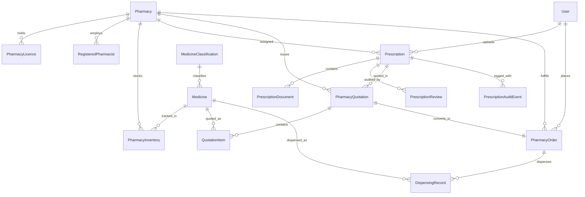

# Everything Local — Pharmacy & Medical Marketplace Ecosystem

## 1. Overview & Architecture

The **Everything Local Pharmacy & Medical Ecosystem** provides an end-to-end hyperlocal healthcare commerce and prescription fulfillment solution. It integrates seamlessly into the existing multi-category retail platform alongside grocery, electronics, and home services.

Unlike standard e-commerce, pharmaceutical dispensing in India is subject to strict statutory requirements under the **Drugs and Cosmetics Act, 1940**, the **Drugs and Cosmetics Rules, 1945**, the **Pharmacy Act, 1948**, and notifications from the **Pharmacy Council of India (PCI)** and state drug licensing authorities (e.g. MP State Pharmacy Council).

The ecosystem connects three distinct stakeholders:
1. **Customers**: Search medicines, view statutory classification badges (OTC, Schedule H, H1), upload digital prescriptions with clinical metadata, compare nearby licensed chemists, receive itemized quotations, and track order fulfillment.
2. **Licensed Pharmacies & Registered Pharmacists**: Distinct, verified chemist entities with Form 20/21 drug licences. Only certified Registered Pharmacists with valid registration credentials (e.g., MPPC Registration Numbers) can access patient prescriptions, review clinical validity, create statutory quotations, and record batch dispensing.
3. **Platform Administrators**: Supervise pharmacy licence validity, drug authority registration numbers, review registered pharmacist credentials, and audit dispensing events.

---

## 2. Core Entities & Data Architecture

### Key Models

- **`Pharmacy`**: Licensed retail chemist entity containing geolocation (`latitude`, `longitude`), operating hours, 24x7 express delivery capabilities, and verification status (`isVerified`).
- **`PharmacyLicence`**: Stores Form 20 (allopathic drugs other than Schedule C/C1/X) and Form 21 (Schedule C/C1 drugs) licence numbers, validity dates, and issuing licensing authority.
- **`RegisteredPharmacist`**: Represents qualified personnel (B.Pharm / M.Pharm / D.Pharm) with statutory State Pharmacy Council registration numbers, council validity, and active duty status.
- **`MedicineClassification`**: Enforces legal scheduling:
  - `OTC`: Over-The-Counter; direct checkout permitted.
  - `SCHEDULE_H`: Prescription mandatory; warning red line label.
  - `SCHEDULE_H1`: Habit-forming / third-generation antibiotics; strict prescription register mandatory.
  - `SCHEDULE_X`: Psychotropic / narcotics; prohibited from online ordering.
  - `MEDICAL_DEVICE`: Regulated diagnostic tools and equipment.
  - `FIRST_AID`: Emergency care supplies.
- **`Medicine`**: Product catalogue with generic composition, strength, manufacturer, pack size, prescription requirement flag (`requiresPrescription`), and schedule code.
- **`Prescription`**: Lifecycle state machine from draft to dispensing.
- **`PrescriptionDocument`**: Multi-page prescription uploads stored exclusively in private non-public storage (`secure_storage/prescriptions/`).
- **`PrescriptionReview`**: Audit trail of clinical review completed by a registered pharmacist.
- **`PharmacyQuotation` & `QuotationItem`**: Itemized pricing, substituted generic equivalents, availability flag, statutory 5% GST, and delivery charges.
- **`DispensingRecord`**: Compliance log storing batch numbers, manufacturing/expiry dates, dispensed quantities, and dispensing pharmacist registration details.

---

## 3. Separation of Concerns & Security Isolation

1. **Storage Isolation**: Prescription files are never saved in the public static directory (`/uploads`). They are written to a sandboxed filesystem path (`secure_storage/prescriptions/`).
2. **Access Control**: Prescriptions can only be viewed by:
   - The uploading customer who owns the prescription (`prescription.userId === req.user.id`).
   - A registered pharmacist employed by the assigned pharmacy (`pharmacist.pharmacyId === prescription.pharmacyId`).
   - Platform super-administrators (`req.user.role === 'ADMIN'`).
   Ordinary merchants, other customers, and public visitors receive HTTP 403 / 404.
3. **Magic Byte File Validation**: Uploads are verified via raw buffer signatures (JPEG `FF D8 FF`, PNG `89 50 4E 47`, PDF `%PDF`, WebP `RIFF....WEBP`). Executable files with renamed extensions are immediately rejected.
4. **Non-Reversible Audit Trails**: All events (`UPLOAD`, `REVIEW`, `QUOTATION_ISSUED`, `ORDER_PLACED`, `DISPENSED`, `CANCELLED`) are appended to `PrescriptionAuditEvent` with client IP and user metadata.

---

## 4. Hyperlocal Geospatial Engine

The module uses the existing `GeospatialEngine` to:
- Detect the customer's delivery locality (Indore radial zones: Palasia, Vijay Nagar, Bhawarkuan, Rajwada, Annapurna, Old Palasia, etc.).
- Calculate real-time Haversine road-distance between the delivery coordinates and licensed chemist stores.
- Filter pharmacies within an allowable delivery radius (e.g. 5.0 - 7.0 km).
- Provide accurate delivery time estimates (15-30 minutes express delivery for local chemists).
