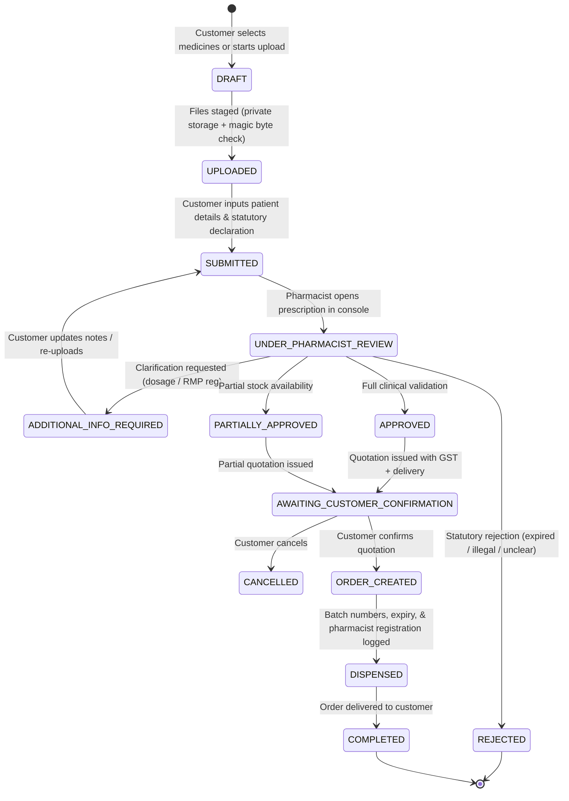

# Prescription Lifecycle & Verification Workflow

## 1. Statutory Prescription State Machine

Under the **Drugs and Cosmetics Rules, 1945** (Rules 65 & 97) and **Pharmacy Act, 1948**, prescription drugs (Schedule H, Schedule H1) may only be dispensed against a valid prescription issued by a Registered Medical Practitioner (RMP).

---

## 2. Step-by-Step Workflow Implementation

### Step 1: Customer Upload & Metadata Submission
1. Customer initiates upload via **Upload Prescription** action.
2. Accepts multi-page files via camera capture, device gallery, or document picker.
3. Supported types: JPEG, PNG, PDF, WebP (strictly verified by buffer magic bytes; extensions are not trusted).
4. Files are stored in sandboxed path: `secure_storage/prescriptions/` (isolated from public static `/uploads`).
5. Customer enters patient metadata:
   - Patient Name & Age
   - Gender
   - Relationship (Self, Parent, Spouse, Child, Other)
   - Preferred licensed pharmacy in delivery radius
   - Delivery address in Indore
   - Doctor / Clinic details (optional notes)
   - Statutory RMP declaration confirmation checkbox.
6. Status becomes `SUBMITTED`.

### Step 2: Pharmacist Inspection Queue
1. Logged-in Registered Pharmacists view pending prescriptions assigned to their pharmacy.
2. Pharmacists open the inspection modal.
3. System logs `PrescriptionAuditEvent` (`ACTION: "REVIEW"`).
4. Documents are fetched through the authenticated streaming endpoint:
   `GET /api/pharmacy/prescriptions/:id/documents/:docId/view`
5. Pharmacist performs clinical and statutory checklist:
   - Doctor Name & Medical Council Registration Number.
   - Patient Name & Age matching submission.
   - Prescription Date (within valid 6-month statutory limit).
   - Medicine name, strength, dosage, and duration.
   - Doctor's physical signature and clinic stamp.

### Step 3: Clinical Review Decision
The pharmacist selects one of four statutory actions:
1. **Approve (`APPROVED`)**: All prescribed medicines are clinically valid and in stock.
2. **Partially Approve (`PARTIALLY_APPROVED`)**: Certain items are available, while others are marked out-of-stock with optional licensed generic substitutes noted.
3. **Request Clarification (`ADDITIONAL_INFO_REQUIRED`)**: Prescription is missing dosage, frequency, or doctor signature. Detailed clarification query sent to customer.
4. **Reject (`REJECTED`)**: Statutory rejection due to expiry (>6 months), missing doctor signature/reg number, altered text, illegibility, or restricted Schedule X substance. Rejection reason recorded permanently in audit logs.

### Step 4: Quotation Generation & Customer Confirmation
1. Pharmacist builds an itemized quotation:
   - Prescribed medicine name & strength.
   - Quantity to dispense.
   - Unit price & subtotal.
   - Statutory 5% GST on medicines.
   - Express delivery fee (e.g. ₹29 or ₹0 above threshold).
2. Customer receives notification and reviews quotation in **My Prescriptions**.
3. **Mandatory Acceptance**: The customer must explicitly accept the itemized bill and substitutes. No card or COD order is created without explicit consent.
4. Upon customer acceptance (`POST /api/pharmacy/quotations/:id/confirm`), an official `PharmacyOrder` is created (`ORDER_CREATED`).

### Step 5: Statutory Dispensing & Packaging
1. Under Rule 65, dispensing records must be maintained.
2. Pharmacist inspects medicine packs and inputs:
   - Manufacturer Batch Number (e.g. `AUG-98214`, `DOLO-2026A`).
   - Expiry Date (must be in future).
   - Packaging verified intact.
3. Dispensing record captures:
   - `dispensedByPharmacistId`
   - `pharmacistRegistrationNumber` (e.g. `MPPC-48291`)
   - Timestamp and order reference.
4. Status transitions to `DISPENSED`, and dispatch to delivery partner is authorized.
