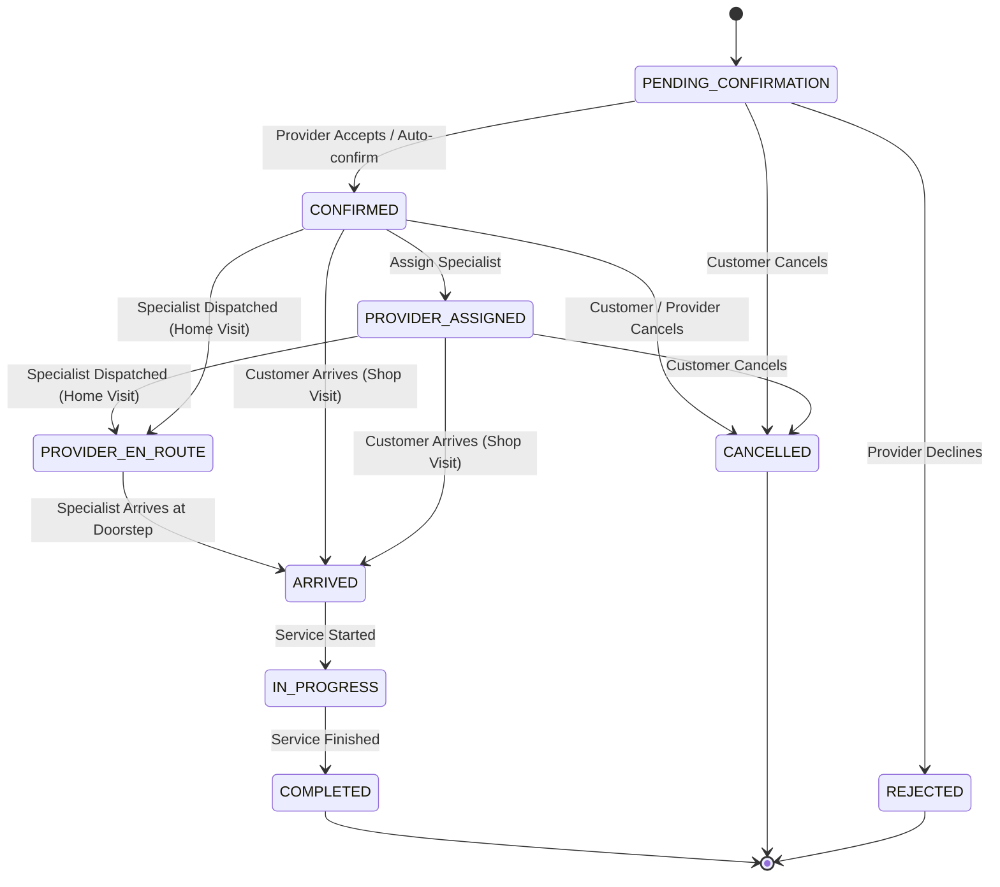

# Everything Local — Service Booking Workflows & Lifecycle

## 1. Booking State Machine & Lifecycle

The booking ecosystem enforces a rigorous 11-stage status lifecycle to track appointment progression with complete transparency between customer, specialist, provider, and platform admin.



### Status Descriptions

1. **`PENDING_CONFIRMATION`**: Customer has submitted the booking request; awaiting provider confirmation.
2. **`CONFIRMED`**: Appointment confirmed for the designated date and time slot.
3. **`PROVIDER_ASSIGNED`**: Specific specialist staff member assigned to lead the appointment.
4. **`PROVIDER_EN_ROUTE`**: Specialist is travelling to customer's home address (applies to `HOME_VISIT`).
5. **`ARRIVED`**: Specialist has reached the doorstep or customer has arrived at the salon/workshop.
6. **`IN_PROGRESS`**: Service execution has begun.
7. **`COMPLETED`**: Work finished, payment settled, and provider earnings released.
8. **`CANCELLED`**: Booking cancelled before commencement with reason logged.
9. **`REJECTED`**: Provider declined request due to unavailability or schedule conflict.
10. **`NO_SHOW`**: Customer or provider failed to appear.
11. **`REFUNDED`**: Fees refunded to customer if advance payment was collected.

---

## 2. Double-Booking Concurrency Resolution

To prevent race conditions where two customers attempt to book the same specialist or provider slot simultaneously, the booking endpoint uses Prisma interactive transactions:

```typescript
const result = await prisma.$transaction(async (tx) => {
  // 1. Double-booking check: Ensure no active booking exists for provider at this date and timeSlot
  const existing = await tx.serviceBooking.findFirst({
    where: {
      providerId: body.providerId,
      bookingDate: body.bookingDate,
      timeSlot: body.timeSlot,
      status: { notIn: ['CANCELLED', 'REJECTED'] }
    }
  });

  if (existing) {
    throw new Error('This appointment slot has just been reserved by another customer. Please choose another time slot.');
  }

  // 2. Create the booking atomically
  const newBooking = await tx.serviceBooking.create({ ... });
  
  // 3. Log audit event
  await tx.bookingStatusEvent.create({ ... });

  // 4. Record pending provider earning
  await tx.providerEarning.create({ ... });

  return newBooking;
});
```

If two concurrent requests target the same slot, the database transaction ensures one commits successfully while the other is rejected with a clear `400 Bad Request` collision message.

---

## 3. Fulfillment Modalities

### A. Shop Visit (`SHOP_VISIT`)
- **Use Case**: Customer visits the provider's physical facility (e.g. hair salon, bridal studio, automotive garage).
- **Travel Fee**: Always ₹0 (`travelFeePaise: 0`).
- **Address Validation**: Provider's shop address and operating hours are shown on the booking pass.
- **Workflow Steps**: `CONFIRMED` -> `ARRIVED` -> `IN_PROGRESS` -> `COMPLETED`.

### B. Home Visit (`HOME_VISIT`)
- **Use Case**: Specialist travels to customer's residence (e.g. electrician, doorstep AC service, deep cleaning, car wash).
- **Travel Fee**: Added to total bill (`provider.homeVisitFeePaise`).
- **Boundary Verification**: Customer's latitude/longitude are verified against provider's `homeVisitRadiusKm`. If distance exceeds radius, booking is blocked before slot reservation.
- **Workflow Steps**: `CONFIRMED` -> `PROVIDER_EN_ROUTE` -> `ARRIVED` -> `IN_PROGRESS` -> `COMPLETED`.

---

## 4. Rescheduling Workflow
- Customer can reschedule upcoming bookings in status `PENDING_CONFIRMATION`, `CONFIRMED`, or `PROVIDER_ASSIGNED`.
- Atomic check ensures the destination date and time slot are available.
- Rescheduling generates a `BookingStatusEvent` noting the previous and newly scheduled times.
- Once a service is `IN_PROGRESS` or `COMPLETED`, rescheduling is prevented.

---

## 5. Post-Service Review & Quality Rating
- Once status transitions to `COMPLETED`, the customer can submit a 1 to 5-star rating with detailed comments.
- Submitting a review recalculates the provider's rolling average rating and increments review count atomically.
- Reviews are displayed publicly on the provider's showcase profile with verified customer attribution.
