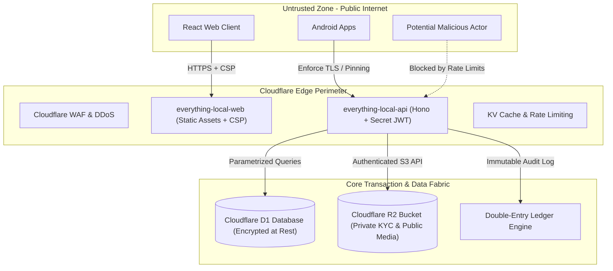

# Everything Local — Security Architecture Recommendations
**Target Architecture, Trust Boundaries & Defense-in-Depth Guidelines**

---

## 1. Trust Boundaries & Security Zones

---

## 2. Authentication Architecture Overhaul

1. **Short-Lived Access Tokens + Refresh Token Rotation:**
   - Reduce JWT expiration from `7d` to `15m`.
   - Issue cryptographically random refresh tokens stored in HTTP-only, Secure, SameSite cookies or secure mobile keystore.
   - Store active refresh token hashes in D1 / KV to support immediate server-side revocation on logout.

2. **Defense Against Brute-Force & Credential Stuffing:**
   - Integrate Cloudflare Turnstile or rate limiting on `POST /api/auth/login` (max 5 failed attempts per IP/username per 15 minutes).
   - Implement temporary account lockout with exponential backoff.

3. **Production SMS Gateway Integration:**
   - Replace in-memory `Map` OTP store in `deliveryPartner.ts` with Cloudflare KV / Redis.
   - Enforce 3-minute OTP expiry and maximum 3 verification attempts per OTP.

---

## 3. Financial Integrity & Ledger Hardening

1. **Strict Canonical Pricing Enforcement:**
   - Never accept `unitPricePaise` from client requests.
   - Checkouts must lock item prices from the database inside atomic transactions.
2. **Delivery OTP Handshake for Settlement:**
   - Deliveries must only settle when the recipient confirms delivery via OTP.
   - Remove merchant self-delivery transitions for platform-dispatched orders.
3. **Double-Entry Reconciliation Checks:**
   - Schedule automated daily reconciliation jobs comparing total captured online payments against total merchant payouts and platform commission debits.
