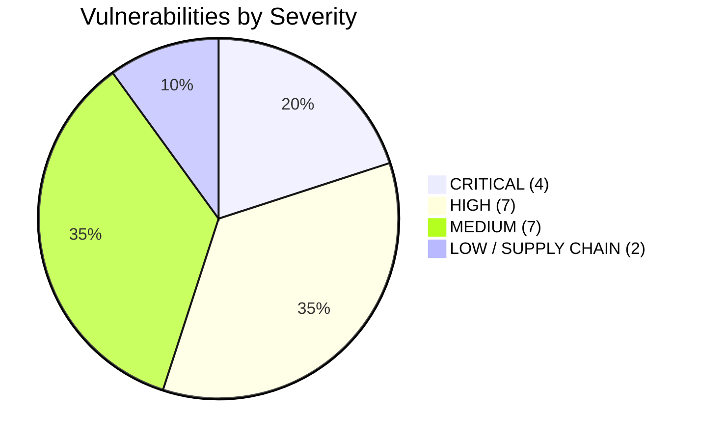

# Everything Local — Vulnerability Register & Risk Matrix

| Finding ID | Title | Severity | CVSS v3.1 | Status | Owner / Module | Priority |
|---|---|---|---|---|---|---|
| **VULN-001** | Arbitrary Client-Controlled Price & Negative Quantity in Multi-Store Checkout | **CRITICAL** | 9.8 | Confirmed | Backend / Order Engine | **P0** |
| **VULN-002** | Hardcoded Default JWT Secret in Production Cloudflare Worker | **CRITICAL** | 9.8 | Confirmed | Cloudflare / Auth | **P0** |
| **VULN-003** | Hardcoded Master OTP Backdoor in Delivery Partner Auth | **CRITICAL** | 9.8 | Confirmed | Backend / Delivery Auth | **P0** |
| **VULN-004** | Arbitrary File Read & Path Traversal in Prescription Streaming | **CRITICAL** | 9.1 | Confirmed | Backend / Pharmacy | **P0** |
| **VULN-005** | Merchant Self-Verification & Statutory KYC Bypass | **HIGH** | 8.5 | Confirmed | Backend / Merchant Auth | **P1** |
| **VULN-006** | Merchant-to-Merchant KYC Document IDOR in Cloudflare Worker | **HIGH** | 7.7 | Confirmed | Cloudflare / Storage | **P1** |
| **VULN-007** | Mass Assignment in Merchant Product Update Endpoint | **HIGH** | 7.5 | Confirmed | Backend / Merchant Portal | **P1** |
| **VULN-008** | Fraudulent Payout Trigger via Merchant Unilateral DELIVERED Status | **HIGH** | 8.1 | Confirmed | Backend / Merchant Portal | **P1** |
| **VULN-009** | Premature Financial Settlement of READY_FOR_PICKUP Orders | **HIGH** | 7.5 | Confirmed | Core / Settlement Engine | **P1** |
| **VULN-010** | Hardcoded Encryption Key & Static Salt for Bank Accounts | **HIGH** | 7.4 | Confirmed | Core / Fintech Service | **P1** |
| **VULN-011** | In-Memory Webhook Deduplication and Missing Signature Enforcement | **HIGH** | 7.5 | Confirmed | Core / Payment Engine | **P1** |
| **VULN-012** | Concurrency TOCTOU Race Condition in Delivery Task Acceptance | **MEDIUM** | 5.3 | Confirmed | Backend / Rider Routing | **P2** |
| **VULN-013** | Missing Rider Ownership Check on Task Handover Delivery | **MEDIUM** | 6.5 | Confirmed | Backend / Rider Routing | **P2** |
| **VULN-014** | Widespread BOLA/IDOR in Household Management | **MEDIUM** | 6.5 | Confirmed | Backend / Household | **P2** |
| **VULN-015** | Negative Quantity and Integer Underflow in Community Campaigns | **MEDIUM** | 5.3 | Confirmed | Backend / Community | **P2** |
| **VULN-016** | Missing Rate Limiting & Account Lockout on Auth Endpoints | **MEDIUM** | 5.3 | Confirmed | Backend / Security | **P2** |
| **VULN-017** | Insecure Session Storage & Enabled Device Backup in Android App | **MEDIUM** | 5.5 | Confirmed | Android / Mobile Native | **P2** |
| **VULN-018** | Missing HTTP Security Headers & Content Security Policy (CSP) | **LOW** | 4.3 | Confirmed | Cloudflare / Frontend | **P3** |
| **VULN-019** | Cloudflare Edge Runtime Incompatibility with Filesystem Writes | **MEDIUM** | 5.3 | Confirmed | Architecture / Edge | **P2** |
| **VULN-020** | High/Critical Vulnerabilities in Transitive Node Dependencies | **LOW** | 6.5 | Confirmed | Infrastructure / DevSecOps | **P3** |

---

### Risk Distribution

